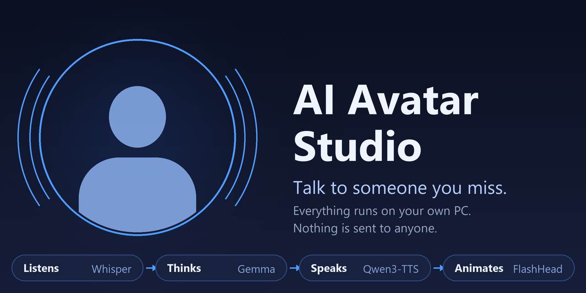
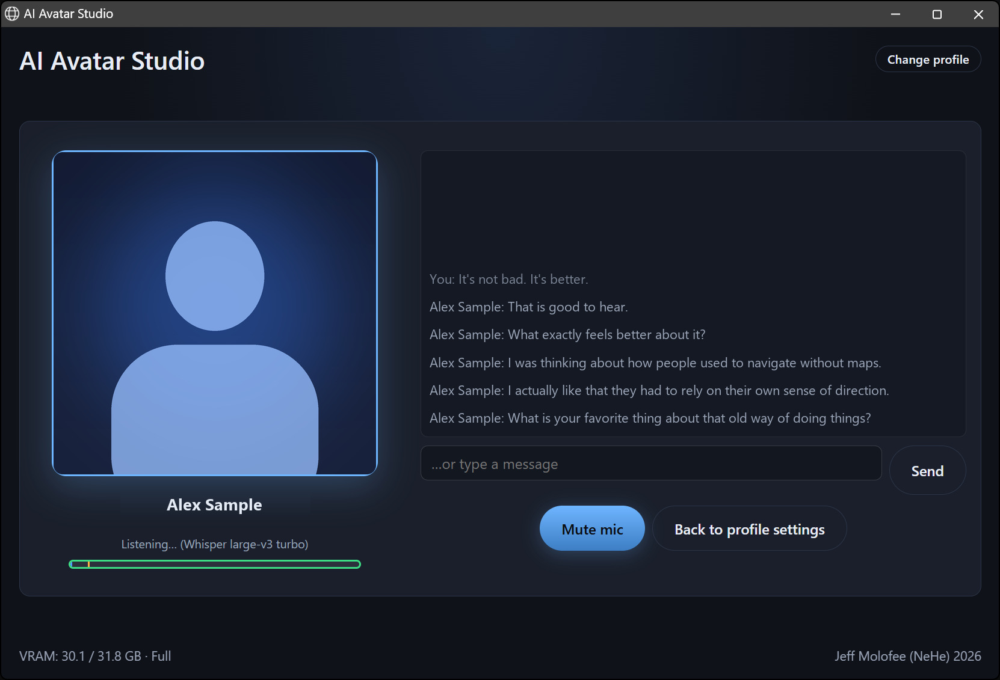

# AI Avatar Studio

**Bring a person back for a conversation: someone you miss, or even yourself.** AI Avatar Studio is not a chat program. It rebuilds one real person: their face from a single photo, their voice from a recording, and who they were from what you can tell it about them. Then you talk with them out loud. Everything runs on your own PC. Nothing is sent to anyone.

I made this because I wanted to bring people back from the dead, even just for a conversation. It could be a parent or grandparent who has passed, or you: sit down and talk to yourself, or to the person you used to be. You tell it about the person, give it their face and their voice, and it tries to be them: it knows their family, their stories, how they talked, and it answers out loud, with their face, in their voice.

## What it does

- **Learns the person.** A Facts page holds everything you know about them (birthday, family, interests, how their name is pronounced, how they spoke). The avatar uses it in conversation and works out how the person comes across from what you wrote.
- **Keeps learning.** While you talk, the avatar notes lasting things you tell it (a birthday, a name, something you like) in an **AI Learned** list (`facts/learned.txt`) and says "Noted: ..." when it does. You can read, fix or delete anything in it. What you wrote under Facts is always the truth: it outranks what the avatar learned, and a fact that contradicts Facts is never saved. It also notes what you tell it about itself ("you're a singer" becomes a fact about the avatar), and then gets curious: it works out a follow-up question ("what kind of songs do I sing?") and asks it the next time the room goes quiet. It may also ask you things, such as your name. Facts and AI Learned can be as long as you like: the chat model only reads about 4,000 tokens at a time, so before each reply both are searched on the processor (milliseconds, no graphics memory) and only the parts that matter for what you just said go in. Short ones go in whole.
- **Faces.** Add a photo with your webcam or by upload. The program finds the face, levels it, centres and zooms it, crops it to the exact framing the video engine uses, and tells you plainly if the photo is blurry, too dark, turned away or has closed eyes. With the webcam it takes the shot itself when you look straight ahead with your eyes open and in focus, and keeps the best. Keep up to **5 photos** per person and swap between them with one click.
- **Voices.** Read a short passage aloud or upload an audio clip, the same way you add a photo, and cancel or skip it during setup (up to **5 recordings** per person). The program picks the clearest speech from all of them and builds one clean reference clip to copy the voice from. It attempts to recreate their voice; how close it gets depends on the recording. A voice you like can be locked so it never changes.
- **Talks back.** You speak (or type), it listens, thinks, and answers with synthesized speech and a lip-synced video of the face.
- **Private.** The chat model, the voice model, the speech recognition and the video model all run locally. Profiles live in `data/profiles/<name>/` and are never part of the repository.

## Keeping it interactive

A conversation feels dead if every reply has a pause in front of it. A lot of the work here is hiding or removing delays, though it is not always possible:

- Every model is loaded at start-up (with a progress screen), so the first reply is not slow.
- Replies are spoken sentence by sentence while the model is still writing, with a short first sentence so the voice starts early.
- Speech recognition runs live while you talk, so your words appear as you speak. The status line always says what is happening: **Thinking** (it is working on a reply: you can talk, and it stops for you), **Speaking** (its voice is playing) and **Listening** (it has nothing to say). The microphone is ignored only while its voice is playing (its voice and yours cannot be told apart), so it never hears itself; the gaps between its sentences are open, so you can interrupt it there and it drops the rest of its reply. If you start talking while it is still thinking about something you said or typed, your parts are joined into one question. Its opening introduction always comes first, and anything you say before it is answered after it. Sound from the moment just before the microphone opens is kept, so your first words are not lost.
- While it thinks, the face is never frozen: a bank of calm "waiting" animations plays, and every clip starts and ends on the same still frame, so clips join without a visible jump. The talking clips ease out of and back onto that frame, so the face does not snap between a waiting animation and speech.
- Models are chosen to fit your graphics card, so nothing swaps out of memory mid-conversation.

## Hardware

| Graphics memory | Chat model | Speech recognition |
|---|---|---|
| **32 GB** (preferred) | Gemma 3 12B | Whisper large-v3 turbo on the GPU |
| 20 to 28 GB | Gemma 3 12B | Whisper small on the GPU |
| **16 GB** (tight) | Gemma 3 4B (smaller) | Whisper distil-small on the CPU |

On a 16 GB card it fits, with about 1 GB to spare. Tested by reserving the rest of a larger card, so that Windows and the app had exactly 16 GB: it loaded, transcribed speech and answered four turns in a row with no memory errors, using about 11.5 GB when idle and 12.5 GB while it answers, plus Windows' own share, for a peak of about 15 GB. The first sound took 7 to 10 seconds. Close other programs that use the graphics card (browsers playing video, games). It has not been run on a real 16 GB card, whose speed will differ.

Windows 10/11, an NVIDIA card (RTX 20-series or newer), and about 30 GB of free disk space (Python 3.11 only if you run from the source code). The first start downloads about 22 GB of models, once.

## Install and run

1. Download the `.zip` from the latest [Release](../../releases) and extract it into the folder, or onto the drive, where you want the app and its downloads to live (about 30 GB).
2. Run **AI-Avatar-Studio.exe**. The first run unpacks the app into an `AI Avatar Studio` folder beside it, installs Python and the packages itself (you do not need to install Python), and starts the app. The chat model, video engine and voice (about 22 GB) download with progress on the app's start screen. After that it starts straight away.

Windows may warn about an unknown publisher, because the program is not signed: choose **More info**, then **Run anyway**.

### Running from the source code

The source is this repository (**Code**, then **Download ZIP**, or `git clone`).

Install Python 3.11 (tick "Add Python to PATH"), then double-click **Start AI Avatar Studio App.bat** (own window) or **Start AI Avatar Studio Web.bat** (browser tab). If anything is missing, the first launch runs **install.bat** for you. **Stop AI Avatar Studio.bat** closes everything. The server runs hidden, with no console window; its log is `data/_server.log`. **Build Standalone.bat** builds the release files (`AI-Avatar-Studio.exe` and `README.md`) into `dist/`; it needs [uv](https://docs.astral.sh/uv/).

### Use your own chat model

Put a chat-tuned `.gguf` file in `brain/models/` and name it `custom-<anything>.gguf`. It is used instead of the built-in choice. Delete it to go back.

## How it is built

| Part | What it uses |
|---|---|
| Server and pages | Python, FastAPI, plain HTML/CSS/JavaScript (no framework) |
| Chat | llama.cpp's server running a Gemma model |
| Voice | Qwen3-TTS 1.7B voice cloning |
| Hearing | Whisper (GPU) or faster-whisper (CPU) |
| Face video | SoulX-FlashHead-Lite, a lip-sync video model |
| Photo checks | MediaPipe face landmarks and OpenCV, in the browser and on the server |

| Folder | What |
|---|---|
| `app/` | The Python server: pages, profiles, photo and voice checks, chat |
| `static/` | The web pages |
| `brain/` | The chat model and its server (downloaded by the installer) |
| `ml/` | Voice and video code and the Python environment |
| `data/profiles/<name>/` | One folder per person: `photo/`, `voice/`, `facts/` (and `cache/`, made by the app and safe to delete) (git-ignored) |

## Limits

- The video model redraws the face for every frame, so it works best on real photos and badly on cartoons.
- Voice cloning from a short, noisy recording will not sound like the person. More clean speech helps a lot.
- It is a likeness built from what you give it, not the person. Use it with respect, and only with the voice and face of people you have the right to use.

## License

Created by Jeff Molofee (NeHe) 2026  
Free to use and modify

The models this program downloads (the chat model, the voice, speech recognition and the video engine) and the libraries it uses have their own licenses, which apply to them. They are not part of this repository.

## About

Built by Jeff Molofee (NeHe). I love AI and I love tech, and I'm looking for work.
